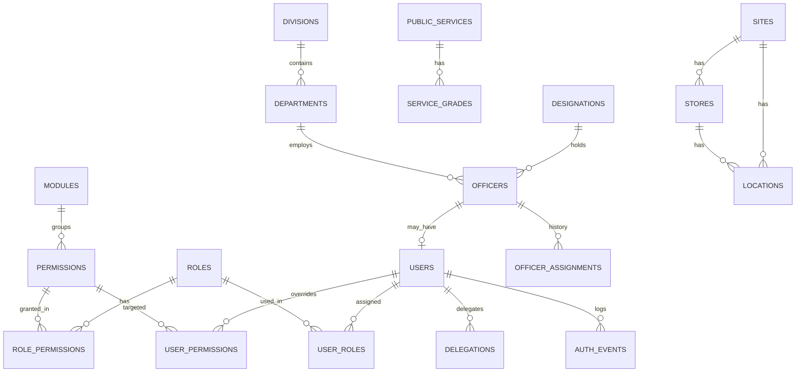
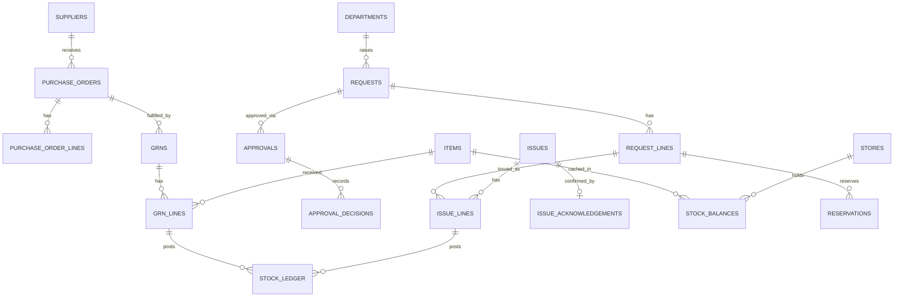
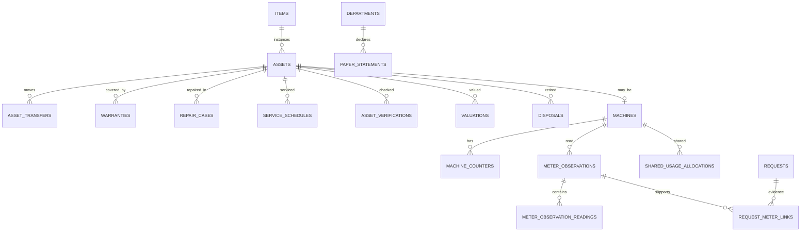

# MPCLG Ministry Inventory & Asset Management System: Project Blueprint

> Version 1.0 · 17 Nov 2026 · Stack: PHP + Laravel + MySQL · Architecture: 3-tier, API-first, role-based access (RBAC)
> Source documents: *Ministry Inventory Project Proposal v2.0 (6 Nov 2026)* and the ministry organisation chart.

---

## 0. How to use this file

This is the single source of truth for the build. We build **bit by bit**, one phase at a time (Section 14). For every step:

1. Read the relevant section here (data model → rules → API).
2. Build in this order: **migration → model → factory/seeder → service → request/resource/controller/route → policy/permission → tests → API docs**.
3. Do not skip ahead. Do not add tables, columns or endpoints that are not in this file without updating this file first.
4. If something is ambiguous, check **Section 16 (Open decisions)** and ask before guessing.

Suggested first message when starting a coding session (Claude Code, Cursor or similar):

> "Read `MPCLG_Inventory_System_Blueprint.md`. We are starting **Phase 0 and Phase 1**. Follow Sections 3 to 7 and 14 exactly. Build step by step, run the tests after each step, and tell me what you built before moving on."

---

## 1. Project summary

A new internal web application for the Ministry of Provincial Councils and Local Government (official ministry name to be confirmed, see Section 16) to manage ministry goods from receipt into Stores through issue, assignment, maintenance and disposal. It replaces the outdated inventory application and the paper registers.

**What it must be able to answer at any time:** what stock is available, which department received it, who holds each asset, and who authorised each transaction, with supporting records.

### 1.1 Your requirements (from the project owner)

| # | Requirement | Where it is handled |
|---|---|---|
| 1 | Role-based access; admin can turn each access **on or off** per user | Section 5 |
| 2 | System fully managed through **APIs** | Sections 3, 4, 10 |
| 3 | Create users and **disable user accounts** when needed | Section 6 |
| 4 | **Three-tier architecture** | Section 3 |
| 5 | A proper MD file to start the project | This file |
| 6 | Plan the **database first**, with all needed columns in each table | Sections 7 and 8 |
| 7 | Build the system gradually from this file | Sections 0 and 14 |

### 1.2 Core principles (never break these)

1. **Stock is calculated, not edited.** Balances come from an append-only stock ledger. Fixes are done by linked reversal, never by update or delete.
2. **Consumables vs assets.** Consumables (A4 paper) are tracked by quantity. Controlled assets (computers, printers, furniture) are tracked individually with a permanent asset number and QR code.
3. **Every action has a named officer** and an approval trail. Nobody approves their own request.
4. **History is never rewritten.** A later change to a designation or department name must not alter an earlier transaction (we store snapshots).
5. **No hard deletes** on business data. Use status flags and soft deletes on master data only.
6. **Unknown is allowed.** Never invent historical purchase or warranty dates and never store an unknown meter reading as zero.
7. **Approving the system grants no new spending authority.** Approval power always follows the ministry's written delegations.

### 1.3 First release boundary

**In scope:** internal ministry stores, consumables, movable assets.
**Out of scope (separate approval):** tender evaluation, supplier payments, payroll, vehicle fleet operations, buildings and land. PO and invoice references are kept, but payment stays with Finance.

---

## 2. Technology stack and decisions

| Layer | Choice | Notes |
|---|---|---|
| Language | PHP 8.3+ | |
| Framework | Laravel (current stable release) | API-only backend (no Blade business logic) |
| Database | MySQL 8.x, InnoDB, `utf8mb4` | Design with MySQL Workbench (EER diagram from Section 8) |
| API auth | Laravel Sanctum (personal access tokens) | Tokens revoked on user deactivation |
| Authorisation | **Custom RBAC** (tables in Section 7.1) + Laravel Policies | Custom tables, because we need per-user allow/deny overrides, scopes and expiry |
| Validation | Form Requests | |
| Queue/cache | Database or Redis queue; cache for permission lookups | |
| API docs | OpenAPI (Scribe or L5-Swagger) | Generated and kept up to date each phase |
| Tests | Pest (or PHPUnit) | |
| Frontend (Tier 1) | Separate SPA: React 19 + TypeScript + Vite, Material UI 9 (MUI X DataGrid), React Router, TanStack Query (`frontend/`) | **Decided** (Section 16, decision 2) |
| Time | Store UTC, display `Asia/Colombo` | Consistent Sri Lanka time in the UI |
| Languages | English first; columns ready for Sinhala/Tamil names | Confirm languages, Section 16 |

**Conventions**

- Primary keys: `BIGINT UNSIGNED AUTO_INCREMENT`. Add a `public_id` (ULID) on tables exposed through URLs (users, requests, assets) so internal IDs are not guessable.
- Money: `DECIMAL(18,2)`. Quantities: `DECIMAL(18,3)`. Never use floats.
- Enumerations: `VARCHAR` + PHP backed enum + `CHECK` constraint (easier to evolve than MySQL `ENUM`).
- Foreign keys: `ON DELETE RESTRICT`, `ON UPDATE CASCADE`. Index every FK and every status/date column used in filters.
- Table names: plural `snake_case`. Column names: `snake_case`. Booleans: `is_*` / `has_*`.

---

## 3. Three-tier architecture

```
┌──────────────────────────────────────────────────────────────┐
│ TIER 1 · PRESENTATION                                         │
│ Web SPA (desktop browser) + mobile QR landing page            │
│ Renders data, collects input. NO business rules. NO DB access │
└───────────────────────────────┬──────────────────────────────┘
                                │ HTTPS · JSON · /api/v1/*
┌───────────────────────────────▼──────────────────────────────┐
│ TIER 2 · APPLICATION / BUSINESS LOGIC  (Laravel API)          │
│ Routes → Middleware → Controllers (thin) → Form Requests      │
│ → Services (rules, transactions) → Repositories → Models      │
│ Policies/Gates · API Resources · Events/Jobs · Audit          │
└───────────────────────────────┬──────────────────────────────┘
                                │ Eloquent / Query Builder (PDO)
┌───────────────────────────────▼──────────────────────────────┐
│ TIER 3 · DATA                                                 │
│ MySQL 8 · migrations · seeders · constraints · backups        │
│ Restricted DB user (no DDL in production, no UPDATE/DELETE    │
│ on append-only tables)                                        │
└──────────────────────────────────────────────────────────────┘
```

### 3.1 Responsibility rules

| Tier | May do | Must NOT do |
|---|---|---|
| Presentation | Call API, display, client-side convenience validation, hide buttons by permission | Enforce security, calculate stock, talk to the database |
| Application | Authenticate, authorise, validate, run business rules, open transactions, write audit | Contain HTML views or SQL scattered in controllers |
| Data | Store, enforce integrity (FKs, uniques, checks), index | Hold business workflow logic (no stored procedures) |

> The frontend hides buttons by permission for convenience, but **the API always re-checks every permission**. Hiding a button is never security.

### 3.2 Laravel folder structure (Tier 2)

```
app/
├── Enums/                      # StatusEnums, MovementType, DecisionType ...
├── Http/
│   ├── Controllers/Api/V1/     # thin: validate → call service → return resource
│   ├── Middleware/             # EnsureUserActive, CheckPermission, ForceJson, RequestId
│   ├── Requests/               # one FormRequest per write endpoint
│   └── Resources/              # API Resources (response shape)
├── Models/                     # Eloquent models (relationships, casts only)
├── Policies/                   # row-level rules (own department, store scope, not-self-approve)
├── Repositories/               # optional query layer for complex reads
├── Services/                   # ALL business rules live here
│   ├── Access/                 # UserService, RoleService, PermissionResolver
│   ├── Organisation/
│   ├── Catalogue/
│   ├── Stock/                  # LedgerService, ReservationService, CountService
│   ├── Procurement/            # GrnService
│   ├── Requests/               # RequestService, IssueService, ApprovalService
│   ├── Assets/                 # AssetService, TransferService, RepairService
│   └── Paper/                  # MeterService, PaperReviewService
├── Events/ Listeners/ Jobs/    # notifications, audit, reconcile jobs
├── Support/                    # ApiResponse, DocumentNumber generator, IdempotencyKey
database/
├── migrations/                 # one migration per table, ordered by Section 7
├── factories/
└── seeders/                    # modules, permissions, roles, divisions, designations ...
routes/api_v1.php
tests/Feature/  tests/Unit/
```

### 3.3 Request lifecycle

`Request → RequestId middleware → auth:sanctum → EnsureUserActive → CheckPermission(permission code) → FormRequest validation → Controller → Service (DB transaction: business rules + ledger + audit) → API Resource → JSON response`

---

## 4. API standards

- Base URL: `/api/v1`. All requests and responses are JSON. Version in the URL.
- Auth: `Authorization: Bearer <token>` (Sanctum). Tokens expire (configurable, default 8 h) and are revoked on logout/deactivation.
- REST naming: plural nouns, actions as sub-resources, e.g. `POST /users/{id}/deactivate`.
- IDs in URLs: use `public_id` (ULID) for users, requests, assets, GRNs and issues.

**Success envelope**

```json
{ "success": true, "message": "User created.", "data": { }, "meta": { "request_id": "01J..." } }
```

**List envelope (pagination, filter, sort)**

`GET /users?page=1&per_page=25&sort=-created_at&filter[status]=active&search=perera`

```json
{ "success": true, "data": [ ], "meta": { "page": 1, "per_page": 25, "total": 120, "last_page": 5 } }
```

**Error envelope**

```json
{ "success": false, "message": "Validation failed.", "code": "VALIDATION_ERROR",
  "errors": { "email": ["The email has already been taken."] }, "meta": { "request_id": "01J..." } }
```

| HTTP | `code` | When |
|---|---|---|
| 401 | `UNAUTHENTICATED` | Missing/expired token |
| 403 | `FORBIDDEN` / `ACCOUNT_DISABLED` / `PERMISSION_DENIED` | Not allowed, or user inactive |
| 404 | `NOT_FOUND` | |
| 409 | `CONFLICT` / `DUPLICATE_POSTING` | Duplicate GRN/issue, stale version |
| 422 | `VALIDATION_ERROR` / `BUSINESS_RULE_VIOLATION` | e.g. issue > approved qty, self-approval |
| 423 | `ACCOUNT_LOCKED` | Too many failed logins |
| 403 | `PASSWORD_CHANGE_REQUIRED` | Temporary password not yet changed (only `/auth/me`, `/auth/logout`, `/auth/change-password` allowed) |
| 405 | `METHOD_NOT_ALLOWED` | |
| 429 | `RATE_LIMITED` | |
| 500 | `SERVER_ERROR` | Unexpected error (details only when `APP_DEBUG=true`) |

**Idempotency:** every *posting* endpoint (post GRN, post issue, post adjustment, receive transfer) requires an `Idempotency-Key` header. Repeating the same key returns the original result and **never** changes stock twice.

**Optimistic locking:** editable documents carry `version_no`. Updates must send the current `version_no`; mismatch returns `409`.

**Every endpoint** is protected by exactly one permission code from the catalogue (Section 5.2).

---

## 5. Access control (RBAC) design

### 5.1 Concepts

| Concept | Meaning |
|---|---|
| **Module** | A feature area (e.g. `a4_paper`, `assets`). Admin can switch a whole module on/off, useful for phased go-live. |
| **Permission** | One action, e.g. `goods_request.approve`. Has a global on/off switch. |
| **Role** | A named bundle of permissions (e.g. Storekeeper). |
| **User role assignment** | Gives a user a role, optionally **scoped** (global / division / department / store) and **time-limited**. |
| **User permission override** | Admin turns **one specific permission ON (allow) or OFF (deny)** for **one specific user**, optionally scoped and time-limited. This delivers "turn on/off every access each user has". |
| **Delegation** | A deputy acts for an approver for a stated period, scope and written reference. |

### 5.2 Permission resolution algorithm (implement in `PermissionResolver`)

```
can(user, permissionCode, scope?):
 1. If user.status != 'active' or account locked                    → DENY
 2. If the permission's module is disabled or permission.is_enabled=0 → DENY
 3. If user_permissions has an unexpired, unrevoked DENY matching the scope → DENY   (explicit deny beats everything)
 4. If user_permissions has an unexpired, unrevoked ALLOW matching the scope → go to 6
 5. Else if any active, unexpired user_role (matching scope) of the user has the permission via role_permissions → go to 6
    Else if an active delegation gives it to the user for this scope/time → go to 6
    Else                                                              → DENY
 6. Run business policy checks (see 5.4: self-approval, limits, status)   → ALLOW or DENY
```

- Cache the resolved permission set per user, keyed by `users.permission_version`. Increment `permission_version` on any role/permission/override/status change so the cache invalidates instantly.
- `GET /auth/me` returns the user's **effective permissions** so the frontend can show/hide features.

### 5.3 Permission naming and catalogue

Format: `<resource>.<action>`, with the module stored separately. Seed the following (extend later by adding rows, never by hard-coding checks):

| Module | Permission codes |
|---|---|
| `access` | `user.view` `user.create` `user.update` `user.deactivate` `user.reactivate` `user.reset_password` `user.revoke_tokens` `role.view` `role.manage` `permission.view` `permission.assign_role` `permission.override_user` `permission.toggle_global` `module.toggle` `delegation.manage` `audit.view` `settings.manage` |
| `organisation` | `organisation.view` `division.manage` `department.view` `department.manage` `site.manage` `store.manage` `location.manage` `officer.view` `officer.manage` `designation.manage` |
| `catalogue` | `item.view` `item.manage` `category.manage` `unit.manage` `supplier.view` `supplier.manage` |
| `receiving` | `po.view` `po.manage` `grn.view` `grn.create` `grn.inspect` `grn.approve_post` `grn.reverse` `supplier_return.manage` |
| `requests` | `request.view_own` `request.view_department` `request.view_all` `request.create` `request.submit` `request.certify` `request.approve` `request.reject` `request.return` `request.cancel` `issue.create` `issue.post` `issue.reverse` `issue.acknowledge` `return.create` `return.inspect` `reservation.manage` |
| `stock` | `stock.view` `ledger.view` `count.create` `count.record` `count.approve` `adjustment.create` `adjustment.approve` |
| `a4_paper` | `machine.manage` `meter.record` `meter.verify` `paper_statement.manage` `shared_usage.review` `a4.exception_approve` |
| `assets` | `asset.view` `asset.create` `asset.update` `asset.print_qr` `transfer.create` `transfer.approve` `transfer.dispatch` `transfer.receive` `loan.manage` `verification.perform` `valuation.manage` `valuation.approve` `disposal.manage` `disposal.approve` |
| `maintenance` | `warranty.manage` `repair.create` `repair.approve` `repair.dispatch` `repair.update` `repair.close` `service.manage` |
| `reports` | `dashboard.view` `report.stock` `report.requests` `report.a4` `report.assets` `report.audit` `export.pdf` `export.spreadsheet` `print.forms` |

### 5.4 Rules enforced on top of permissions (policies)

1. **No self-approval:** an officer cannot approve their own request, GRN, adjustment or transfer.
2. **Separate approver for adjustments:** the approver of a stock adjustment must differ from the person who recorded the count.
3. **Scope:** a Chief Clerk sees/creates requests only for their own department; a Storekeeper only for their assigned store(s).
4. **Approval limits:** approval steps carry an amount/quantity limit (Section 7.9). Above the limit → escalate to the next tier.
5. **Delegation** must record period, scope and written reference.
6. **System Administrator and Internal Audit do NOT confer financial approval authority.** The seeded `system_admin` role gets **only** `access.*`, `organisation.*` and settings permissions. There is **no `is_super_admin` bypass** that skips checks.
7. **Lock-out protection:** the last active user holding `role.manage` + `permission.override_user` cannot be deactivated, nor can a user remove their own last administrative permission.
8. Every change to roles, permissions, overrides or user status is written to `audit_logs` with a mandatory reason.

### 5.5 Seeded roles (starting point, adjustable by admin)

| Role code | Based on org chart / proposal | Key permissions (summary) |
|---|---|---|
| `system_admin` | IT Division | Access management, organisation master data, settings. **No approvals.** |
| `secretary_view` | Secretary / Additional Secretaries | Dashboards, reports (read), escalated approvals within delegation |
| `cfo` | Chief Finance Officer | Finance controls, escalated approvals, valuation/disposal approval |
| `chief_accountant` | Chief Accountant | Escalated approvals, GRN approval, count/adjustment approval |
| `accountant_supply` | Accountant (Supply) | Routine approval of requests, GRNs, exceptions, A4 exceptions |
| `storekeeper` | Stores (title to be confirmed) | GRN prepare, issue post, stock view, count record, asset create |
| `receiving_officer` | Inspection officer | `grn.inspect`, receive transfers |
| `chief_clerk` | Department coordinator | Create/submit requests, A4 readings and balances, acknowledge receipt |
| `department_head` | Director / SAS / Additional Secretary | `request.certify`, view department |
| `repair_coordinator` | IT / repair coordinator | Repair create/dispatch/update/close, warranty, service |
| `internal_auditor` | Internal Audit | Read-only everywhere, `audit.view`, exports. **No approvals.** |
| `staff` | DO / MSO / KKS and others | `request.view_own`, `asset.view` (own custody) |

---

## 6. User lifecycle (create / update / disable)

**Status values:** `pending` → `active` ⇄ `suspended` → `deactivated`.

| Action | Endpoint | What the service does |
|---|---|---|
| Create | `POST /users` | Creates user (optionally linked to an `officer`), generates temp password or invite, `must_change_password=1`, assigns initial role(s), writes audit |
| Update | `PATCH /users/{id}` | Name/email/officer link; never the password |
| Suspend / reactivate | `POST /users/{id}/suspend`, `/reactivate` | Temporary lock; sets status; bumps `permission_version`; **revokes all tokens** on suspend |
| Deactivate | `POST /users/{id}/deactivate` | Sets `deactivated`, stores reason/date/by, revokes all tokens, ends all role assignments (`valid_to=now`), keeps all history. **Accounts are never deleted.** |
| Reset password | `POST /users/{id}/reset-password` | Temp password or reset link, forces change at next login, revokes tokens |
| Force logout | `POST /users/{id}/revoke-tokens` | Deletes all Sanctum tokens |
| Assign roles | `PUT /users/{id}/roles` | Replace/merge role assignments with scope and validity |
| Toggle one permission | `PUT /users/{id}/permissions/{permission_code}` body `{ "effect": "allow" | "deny" | "inherit", "scope": {...}, "valid_to": "...", "reason": "..." }` | `inherit` removes the override. Bumps `permission_version`, audits |

**Login rules:** failed-attempt counter, lock after N failures (default 5) for a set period, `last_login_at/ip` stored, every login/logout/failed attempt written to `auth_events`. A deactivated or suspended user gets `403 ACCOUNT_DISABLED` even with a valid token. Optional TOTP MFA (Section 16).

**An officer leaving or transferring** → deactivate the user (history kept), end the `officer_assignment`, and the system lists assets/requests still assigned to that officer for reassignment.

---

## 7. Database design

### 7.0 Conventions used in the table definitions

- `[std]` = standard columns on the table: `id BIGINT UNSIGNED PK AI`, `created_at`, `updated_at`, `created_by FK users NULL`, `updated_by FK users NULL`.
- `[master]` = `[std]` + `is_active TINYINT(1) DEFAULT 1` + `deleted_at` (soft delete).
- `[append]` = append-only table: only `id`, `created_at` (and `created_by`). **No updates, no deletes** (enforce with DB privileges and model guards).
- `FK→table` = foreign key. `UQ` = unique. `IDX` = index. `NN` = NOT NULL.
- Date columns named `*_on` are `DATE`; `*_at` are `DATETIME` (UTC).
- `…_snapshot` columns copy a value at the time of the action so later edits cannot rewrite history.

Build order = the order of the sections below. **Phase 1 = 7.1 and 7.2.**

---

### 7.1 Identity and access (Phase 1)

```
modules [std]
  code VARCHAR(40) UQ NN            -- access, organisation, catalogue, receiving, requests, stock, a4_paper, assets, maintenance, reports
  name VARCHAR(100) NN
  is_enabled TINYINT(1) DEFAULT 1   -- admin switch for the whole module
  sort_order INT DEFAULT 0

permissions [std]
  module_id FK→modules NN
  code VARCHAR(100) UQ NN           -- e.g. goods_request.approve  (see 5.3)
  name VARCHAR(150) NN
  description TEXT NULL
  resource VARCHAR(60) NN, action VARCHAR(40) NN
  is_sensitive TINYINT(1) DEFAULT 0 -- financial / approval permissions flagged for audit review
  supports_scope TINYINT(1) DEFAULT 0
  is_enabled TINYINT(1) DEFAULT 1   -- GLOBAL kill switch for this permission
  IDX (module_id)

roles [master]
  code VARCHAR(50) UQ NN
  name VARCHAR(100) NN
  description TEXT NULL
  is_system TINYINT(1) DEFAULT 0    -- seeded roles cannot be deleted (can be edited)

role_permissions  (no [std]; pivot)
  id PK, role_id FK→roles NN, permission_id FK→permissions NN
  granted_by FK→users, granted_at DATETIME
  UQ (role_id, permission_id)

users [std]
  public_id CHAR(26) UQ NN          -- ULID
  officer_id FK→officers NULL UQ    -- NULL for service/IT accounts
  username VARCHAR(60) UQ NN
  email VARCHAR(190) UQ NN
  password VARCHAR(255) NN          -- Argon2id/bcrypt hash
  status VARCHAR(20) NN DEFAULT 'pending'   -- pending|active|suspended|deactivated
  must_change_password TINYINT(1) DEFAULT 1
  password_changed_at DATETIME NULL
  failed_login_count SMALLINT DEFAULT 0
  locked_until DATETIME NULL
  last_login_at DATETIME NULL, last_login_ip VARCHAR(45) NULL
  mfa_enabled TINYINT(1) DEFAULT 0, mfa_secret TEXT NULL   -- encrypted
  permission_version INT UNSIGNED DEFAULT 1                 -- cache-bust counter
  deactivated_at DATETIME NULL, deactivated_by FK→users NULL, deactivation_reason VARCHAR(255) NULL
  IDX (status)
  -- NO soft delete, NO hard delete. Disable via status.

user_roles [std]
  user_id FK→users NN, role_id FK→roles NN
  scope_type VARCHAR(20) NN DEFAULT 'global'   -- global|division|department|store
  scope_id BIGINT UNSIGNED NULL
  valid_from DATETIME NN, valid_to DATETIME NULL
  is_active TINYINT(1) DEFAULT 1
  granted_by FK→users, granted_at DATETIME
  revoked_by FK→users NULL, revoked_at DATETIME NULL, revoke_reason VARCHAR(255) NULL
  UQ (user_id, role_id, scope_type, scope_id, valid_from)
  IDX (user_id, is_active)

user_permissions [std]                -- per-user ON/OFF overrides
  user_id FK→users NN, permission_id FK→permissions NN
  effect VARCHAR(10) NN               -- allow|deny
  scope_type VARCHAR(20) DEFAULT 'global', scope_id BIGINT UNSIGNED NULL
  valid_from DATETIME NN, valid_to DATETIME NULL
  reason VARCHAR(255) NN
  granted_by FK→users, granted_at DATETIME
  revoked_by FK→users NULL, revoked_at DATETIME NULL
  IDX (user_id, permission_id)

delegations [std]
  delegator_user_id FK→users NN, delegate_user_id FK→users NN
  permission_id FK→permissions NULL   -- NULL = all of delegator's approval permissions
  scope_type VARCHAR(20), scope_id BIGINT UNSIGNED NULL
  valid_from DATETIME NN, valid_to DATETIME NN
  written_reference VARCHAR(190) NN   -- letter/circular reference (mandatory)
  attachment_id FK→attachments NULL
  status VARCHAR(20) DEFAULT 'active' -- active|expired|revoked
  revoked_by FK→users NULL, revoked_at DATETIME NULL

personal_access_tokens                -- Laravel Sanctum default table
  + device_name, last_used_at, expires_at, ip_address

password_reset_tokens                 -- Laravel default

auth_events [append]
  user_id FK→users NULL, username_tried VARCHAR(60) NULL
  event VARCHAR(30) NN                -- login_success|login_failed|logout|locked|password_changed|password_reset|token_revoked|mfa_failed
  ip_address VARCHAR(45), user_agent VARCHAR(255)
  IDX (user_id, created_at)
```

### 7.2 Organisation and master records (Phase 1)

```
divisions [master]                    -- the 7 branches under the Secretary
  code VARCHAR(30) UQ NN, name_en NN, name_si NULL, name_ta NULL
  head_designation_id FK→designations NULL
  sort_order INT

departments [master]                  -- a working unit (has its own DO/MSO/KKS cluster)
  code VARCHAR(30) UQ NN
  name_en VARCHAR(150) NN, name_si NULL, name_ta NULL
  division_id FK→divisions NN
  parent_department_id FK→departments NULL
  head_officer_id FK→officers NULL
  coordinator_officer_id FK→officers NULL   -- Chief Clerk / department coordinator
  default_site_id FK→sites NULL
  active_from DATE NN, active_to DATE NULL
  -- a department is NOT a physical location

sites [master]
  code UQ NN, name NN
  site_type VARCHAR(30) NN            -- main_office|bungalow|related_institution|warehouse|other
  address TEXT NULL, phone VARCHAR(30) NULL

stores [master]
  code UQ NN, name NN, site_id FK→sites NN
  store_type VARCHAR(30)              -- general|stationery|it|furniture|other
  responsible_officer_id FK→officers NULL

store_officers (pivot)                -- which officers (Storekeepers) work in which store
  id, store_id FK NN, officer_id FK NN, role VARCHAR(30), valid_from, valid_to, UQ (store_id, officer_id, role)

locations [master]                    -- room / shelf / rack hierarchy
  site_id FK→sites NN, store_id FK→stores NULL
  parent_location_id FK→locations NULL
  location_type VARCHAR(20) NN        -- room|shelf|rack|cupboard|other
  code VARCHAR(40) NN, name VARCHAR(120) NN
  UQ (site_id, code)

public_services [master]              -- S.L.A.S., S.L.Ac.S., S.L.Eng.S., S.L.P.S., S.L.I.C.T.S., contract, other
  code UQ, name

service_grades [master]
  public_service_id FK NN, code VARCHAR(20) NN   -- Special, I, II, III ...
  rank INT, UQ (public_service_id, code)

designations [master]                 -- Secretary, Director, Accountant, DO, MSO, KKS, Driver ...
  code VARCHAR(30) UQ NN, name VARCHAR(120) NN
  category VARCHAR(30)                -- executive|professional|clerical|technical|minor|contract
  is_head_post TINYINT(1) DEFAULT 0

officers [master]                     -- the PERSON. A user account is separate and optional.
  officer_no VARCHAR(30) UQ NN        -- ministry staff/employee number
  full_name VARCHAR(190) NN, name_with_initials VARCHAR(150)
  designation_id FK NN, public_service_id FK NULL, service_grade_id FK NULL
  department_id FK→departments NN
  work_phone VARCHAR(30), work_email VARCHAR(190) NULL
  employment_status VARCHAR(20) NN    -- active|transferred|retired|resigned|suspended
  joined_on DATE NULL, left_on DATE NULL
  -- Do NOT store NIC or personal data unless Finance/HR formally requires it.

officer_assignments [std]             -- history, so old transactions keep correct responsibility
  officer_id FK NN, designation_id FK NN, department_id FK NN
  public_service_id FK NULL, service_grade_id FK NULL
  from_on DATE NN, to_on DATE NULL
  authority_ref VARCHAR(190) NULL     -- transfer/appointment letter ref
  IDX (officer_id, from_on)

system_settings [std]
  group_key VARCHAR(50), key VARCHAR(100) UQ, value TEXT, value_type VARCHAR(20), description VARCHAR(255) NULL
  -- e.g. password policy, session timeout, max failed logins, QR page public/private, A4 rule mode

document_sequences [std]              -- race-safe document numbers (lock row with SELECT ... FOR UPDATE)
  doc_type VARCHAR(20) NN, year SMALLINT NN, scope_key VARCHAR(30) DEFAULT 'ALL'
  prefix VARCHAR(20), last_number INT UNSIGNED DEFAULT 0
  UQ (doc_type, year, scope_key)      -- e.g. GRN-2026-000123, REQ-2026-000045
```

### 7.3 Item catalogue and suppliers (Phase 2)

```
item_categories [master]
  parent_id FK→item_categories NULL, code UQ NN, name NN
  default_tracking_method VARCHAR(20)  -- quantity|asset

units [master]                        -- piece, sheet, ream, pack, box, kg, litre ...
  code UQ NN, name NN, kind VARCHAR(20)  -- count|weight|volume|length|pack

items [master]
  item_code VARCHAR(40) UQ NN
  legacy_code VARCHAR(40) NULL, register_book_no VARCHAR(30) NULL, register_page_no VARCHAR(30) NULL
  name_en VARCHAR(190) NN, name_si NULL, name_ta NULL
  category_id FK NN
  specification TEXT NULL, brand VARCHAR(100) NULL
  tracking_method VARCHAR(20) NN       -- quantity|asset
  base_unit_id FK→units NN             -- ledger always stores in base unit
  purchase_unit_id FK→units NN, issue_unit_id FK→units NN
  reorder_level DECIMAL(18,3) NULL, reorder_qty DECIMAL(18,3) NULL
  has_batch TINYINT(1) DEFAULT 0, has_expiry TINYINT(1) DEFAULT 0
  is_paper TINYINT(1) DEFAULT 0        -- A4 controls apply
  IDX (category_id), IDX (legacy_code)

item_unit_conversions [std]           -- NEVER assume sheets per ream: approve each conversion
  item_id FK NN, from_unit_id FK NN, to_unit_id FK NN
  factor DECIMAL(18,6) NN             -- 1 from_unit = factor × to_unit
  approved_by FK→users, approved_at DATETIME
  UQ (item_id, from_unit_id, to_unit_id)

suppliers [master]                    -- also service/repair providers
  code UQ NN, name VARCHAR(190) NN
  supplier_type VARCHAR(20) NN        -- goods|service|both
  contact_person VARCHAR(150), address TEXT, phone VARCHAR(30), email VARCHAR(190)
  tax_ref VARCHAR(60) NULL
  legacy_code VARCHAR(40) NULL
  duplicate_of_id FK→suppliers NULL   -- set during migration de-duplication
  -- No bank details: payment stays with Finance.

supplier_categories (pivot)
  supplier_id FK, item_category_id FK, UQ (supplier_id, item_category_id)
```

### 7.4 Purchase references, goods receiving and returns (Phase 3)

```
purchase_orders [std]                 -- reference copy of approved POs (PO process itself is not built here)
  public_id CHAR(26) UQ, po_number VARCHAR(40) NN, po_date DATE NN
  supplier_id FK NN, approval_doc_ref VARCHAR(190) NULL
  expected_delivery_on DATE NULL
  status VARCHAR(20) NN               -- open|partly_received|fully_received|closed|cancelled
  version_no INT DEFAULT 1, amended_from_id FK→purchase_orders NULL
  remarks TEXT NULL
  UQ (supplier_id, po_number)

purchase_order_lines [std]
  purchase_order_id FK NN, line_no INT NN, item_id FK NN
  ordered_qty DECIMAL(18,3) NN, unit_id FK NN
  unit_price DECIMAL(18,2), discount DECIMAL(18,2) DEFAULT 0, tax DECIMAL(18,2) DEFAULT 0, other_charges DECIMAL(18,2) DEFAULT 0
  line_total DECIMAL(18,2)
  UQ (purchase_order_id, line_no)
  -- outstanding qty is CALCULATED: ordered − Σ accepted in posted GRN lines

grns [std]
  public_id CHAR(26) UQ, grn_no VARCHAR(30) UQ NN
  receipt_authority_type VARCHAR(20) NN   -- po|donation|transfer_in|opening_balance
  purchase_order_id FK NULL, receipt_authority_ref VARCHAR(190) NULL
  supplier_id FK NULL, store_id FK NN
  receipt_on DATE NN, posting_on DATE NULL
  invoice_no VARCHAR(60) NULL, invoice_on DATE NULL, delivery_note_no VARCHAR(60) NULL
  received_by_officer_id FK NN, inspected_by_officer_id FK NULL, authorised_by_officer_id FK NULL
  authorised_designation_snapshot VARCHAR(120) NULL
  status VARCHAR(25) NN               -- draft|awaiting_inspection|awaiting_approval|posted|rejected|reversed
  subtotal DECIMAL(18,2), discount_total DECIMAL(18,2), tax_total DECIMAL(18,2), other_charges_total DECIMAL(18,2), grand_total DECIMAL(18,2)
  reversal_of_id FK→grns NULL
  idempotency_key VARCHAR(80) UQ NULL
  posted_at DATETIME NULL
  legacy_book_no VARCHAR(30), legacy_page_no VARCHAR(30)
  version_no INT DEFAULT 1
  UQ (supplier_id, invoice_no)        -- duplicate invoice check (NULLs allowed)
  UQ (supplier_id, delivery_note_no)

grn_lines [std]
  grn_id FK NN, po_line_id FK NULL, line_no INT NN, item_id FK NN, unit_id FK NN
  delivered_qty DECIMAL(18,3) NN, accepted_qty DECIMAL(18,3) NN DEFAULT 0
  rejected_qty DECIMAL(18,3) NN DEFAULT 0, pending_qty DECIMAL(18,3) NN DEFAULT 0
  batch_no VARCHAR(60) NULL, expiry_on DATE NULL
  unit_price DECIMAL(18,2), discount DECIMAL(18,2), tax DECIMAL(18,2), other_charges DECIMAL(18,2), line_total DECIMAL(18,2)
  condition_note VARCHAR(255) NULL, rejection_reason VARCHAR(255) NULL
  CHECK (accepted_qty + rejected_qty + pending_qty = delivered_qty)

supplier_returns [std]
  public_id CHAR(26) UQ, return_no VARCHAR(30) UQ, grn_id FK NN, supplier_id FK NN, store_id FK NN
  return_on DATE, reason VARCHAR(255) NN
  replacement_or_claim_ref VARCHAR(190) NULL
  status VARCHAR(20)                  -- draft|approved|posted|closed
  approved_by_officer_id FK NULL, posted_at DATETIME NULL, idempotency_key VARCHAR(80) UQ NULL

supplier_return_lines [std]
  supplier_return_id FK NN, grn_line_id FK NN, item_id FK NN, qty DECIMAL(18,3) NN, unit_id FK NN, batch_no VARCHAR(60) NULL
```

### 7.5 Stock ledger, reservations and counts (Phase 3, extended in Phase 4)

```
stock_ledger [append]                 -- THE source of truth. Never updated or deleted.
  item_id FK NN, store_id FK NN, batch_no VARCHAR(60) NULL, expiry_on DATE NULL
  movement_type VARCHAR(30) NN        -- opening|receipt|issue|return_in|supplier_return|transfer_in|transfer_out|adjustment_plus|adjustment_minus|reversal
  qty_signed DECIMAL(18,3) NN         -- + increases, − decreases, ALWAYS in item base unit
  stock_state VARCHAR(20) DEFAULT 'usable'   -- usable|awaiting_inspection|damaged
  event_on DATE NN                    -- when it happened
  source_type VARCHAR(40) NN, source_id BIGINT UNSIGNED NN, source_line_id BIGINT UNSIGNED NULL
  document_no VARCHAR(40) NULL
  officer_id FK NN, designation_snapshot VARCHAR(120)
  reverses_ledger_id FK→stock_ledger NULL
  remarks VARCHAR(255) NULL
  IDX (item_id, store_id, event_on), IDX (source_type, source_id)
  -- created_at = ENTRY date (differs from event_on for late entries)

stock_balances [std]                  -- cached running balance; rebuilt/verified from ledger by a nightly job
  item_id FK NN, store_id FK NN, batch_no VARCHAR(60) NOT NULL DEFAULT ''
  on_hand_usable DECIMAL(18,3) DEFAULT 0
  on_hand_damaged DECIMAL(18,3) DEFAULT 0
  awaiting_inspection DECIMAL(18,3) DEFAULT 0
  reserved DECIMAL(18,3) DEFAULT 0
  expiry_on DATE NULL
  UQ (item_id, store_id, batch_no)
  CHECK (on_hand_usable >= 0 AND reserved >= 0 AND reserved <= on_hand_usable)
  -- available = on_hand_usable − reserved. Update inside the same transaction as the ledger insert, with SELECT ... FOR UPDATE.

reservations [std]
  request_line_id FK NN, item_id FK NN, store_id FK NN, batch_no VARCHAR(60) NULL
  qty DECIMAL(18,3) NN
  status VARCHAR(20) NN               -- active|consumed|released
  released_reason VARCHAR(255) NULL, released_at DATETIME NULL

stock_count_sessions [std]
  public_id CHAR(26) UQ, session_no VARCHAR(30) UQ, store_id FK NN
  scope_note VARCHAR(255), cut_off_at DATETIME NN
  counted_by_officer_id FK NN
  status VARCHAR(20)                  -- planned|counting|recount|submitted|approved|closed

stock_count_lines [std]
  session_id FK NN, item_id FK NN, batch_no VARCHAR(60) NULL
  expected_qty DECIMAL(18,3) NN       -- ledger balance at cut-off (+/- reconciled intervening movements)
  counted_qty DECIMAL(18,3) NULL, recount_qty DECIMAL(18,3) NULL
  variance_qty DECIMAL(18,3) NULL
  evidence_attachment_id FK NULL, remarks VARCHAR(255)

stock_adjustments [std]
  public_id CHAR(26) UQ, adjustment_no VARCHAR(30) UQ
  count_line_id FK NULL, item_id FK NN, store_id FK NN, batch_no VARCHAR(60) NULL
  qty_delta DECIMAL(18,3) NN, reason VARCHAR(255) NN
  recorded_by_officer_id FK NN, approved_by_officer_id FK NULL
  status VARCHAR(20)                  -- draft|submitted|approved|rejected|posted
  ledger_id FK→stock_ledger NULL, idempotency_key VARCHAR(80) UQ NULL
  CHECK (approved_by_officer_id IS NULL OR approved_by_officer_id <> recorded_by_officer_id)
```

### 7.6 Requests, approvals, issues and returns (Phase 4)

```
requests [std]                        -- department goods request header (also used for A4 paper requests)
  public_id CHAR(26) UQ, request_no VARCHAR(30) UQ NN
  request_type VARCHAR(20) NN         -- goods|a4_paper
  department_id FK NN, department_name_snapshot VARCHAR(150)
  store_id FK NN                      -- store asked to supply
  period_from_on DATE NULL, period_to_on DATE NULL
  purpose VARCHAR(255), required_on DATE NULL, staffing_count INT NULL
  submitted_by_officer_id FK NN, submitted_designation_snapshot VARCHAR(120)
  certified_by_officer_id FK NULL
  status VARCHAR(20) NN               -- draft|submitted|under_review|returned|approved|partly_issued|fully_issued|rejected|cancelled
  receipt_status VARCHAR(20) DEFAULT 'pending'   -- pending|confirmed|discrepancy   (tracked SEPARATELY)
  current_version_no INT DEFAULT 1
  submitted_at DATETIME NULL
  paper_statement_id FK→paper_statements NULL    -- A4 only
  IDX (department_id, status), IDX (store_id, status)

request_lines [std]
  request_id FK NN, version_no INT NN, line_no INT NN
  item_id FK NN, unit_id FK NN
  requested_qty DECIMAL(18,3) NN
  approved_qty DECIMAL(18,3) NULL
  issued_qty DECIMAL(18,3) NN DEFAULT 0     -- cached sum of posted issue lines
  remarks VARCHAR(255)
  UQ (request_id, version_no, line_no)
  CHECK (approved_qty IS NULL OR approved_qty <= requested_qty)
  CHECK (issued_qty <= COALESCE(approved_qty, 0))
  -- Editing quantities/evidence after approval creates a NEW version_no and restarts approval.

approval_flows [master]               -- configurable workflow definitions
  code VARCHAR(40) UQ NN              -- GOODS_REQUEST|A4_REQUEST|GRN|ASSET_TRANSFER|REPAIR_DISPATCH|STOCK_ADJUSTMENT|VALUE_CHANGE|DISPOSAL
  name VARCHAR(120)

approval_flow_steps [std]
  flow_id FK NN, step_no INT NN, name VARCHAR(100)
  required_permission_id FK→permissions NN
  min_amount DECIMAL(18,2) NULL, max_amount DECIMAL(18,2) NULL   -- limit band; above → next step (escalation)
  allow_self_approval TINYINT(1) DEFAULT 0
  can_reduce_qty TINYINT(1) DEFAULT 0
  is_required TINYINT(1) DEFAULT 1
  UQ (flow_id, step_no)

approvals [std]                       -- one row per (document version, step)
  approvable_type VARCHAR(40) NN, approvable_id BIGINT UNSIGNED NN, version_no INT NN
  flow_step_id FK NN
  status VARCHAR(20)                  -- pending|approved|reduced|returned|rejected|superseded
  IDX (approvable_type, approvable_id)

approval_decisions [append]
  approval_id FK NN
  decision VARCHAR(25) NN             -- approve|reduce|return_for_clarification|reject
  decided_by_officer_id FK NN, decided_by_user_id FK NN
  designation_snapshot VARCHAR(120) NN, department_snapshot VARCHAR(150)
  acting_under_delegation_id FK→delegations NULL
  authority_ref VARCHAR(190) NULL
  approved_qty_snapshot JSON NULL     -- per-line approved quantities at decision time
  remarks VARCHAR(500)                -- mandatory for reduce/return/reject
  decided_at DATETIME NN

issues [std]
  public_id CHAR(26) UQ, issue_no VARCHAR(30) UQ NN
  request_id FK NN, store_id FK NN, issue_on DATE NN
  issued_by_officer_id FK NN, received_by_officer_id FK NULL
  status VARCHAR(20) NN               -- draft|posted|reversed        (saving ≠ posting)
  posted_at DATETIME NULL, reversal_of_id FK→issues NULL
  idempotency_key VARCHAR(80) UQ NULL

issue_lines [std]
  issue_id FK NN, request_line_id FK NN, item_id FK NN, unit_id FK NN
  qty DECIMAL(18,3) NN, batch_no VARCHAR(60) NULL
  asset_id FK→assets NULL             -- for asset-tracked items

issue_acknowledgements [std]
  issue_id FK NN UQ, received_by_officer_id FK NN, received_at DATETIME NN
  status VARCHAR(20)                  -- confirmed|discrepancy
  remarks VARCHAR(255)

discrepancies [std]                   -- open until resolved (never silently adjusted)
  discrepancy_type VARCHAR(30) NN     -- receipt_shortfall|damaged_on_receipt|transfer_missing|transfer_refused|count_variance
  source_type VARCHAR(40), source_id BIGINT UNSIGNED
  expected_qty DECIMAL(18,3) NULL, actual_qty DECIMAL(18,3) NULL
  status VARCHAR(20) DEFAULT 'open'   -- open|under_review|resolved
  resolution VARCHAR(255) NULL, resolved_by_officer_id FK NULL, resolved_at DATETIME NULL

department_returns [std]
  public_id CHAR(26) UQ, return_no VARCHAR(30) UQ, department_id FK NN, original_issue_id FK NN, store_id FK NN
  return_on DATE, reason VARCHAR(255), status VARCHAR(20)   -- draft|submitted|inspected|posted
  inspected_by_officer_id FK NULL, posted_at DATETIME NULL, idempotency_key VARCHAR(80) UQ NULL

department_return_lines [std]
  department_return_id FK NN, issue_line_id FK NN, item_id FK NN
  qty_returned DECIMAL(18,3) NN, qty_accepted DECIMAL(18,3) NULL   -- only ACCEPTED qty goes back to stock
  condition VARCHAR(30), remarks VARCHAR(255)
```

### 7.7 A4 paper control (Phase 5)

```
machines [master]                     -- printer/photocopier (owned asset or leased)
  asset_id FK→assets NULL UQ          -- owned machine
  leased_reference VARCHAR(100) NULL  -- leased machine
  model VARCHAR(120), location_id FK→locations NULL
  responsible_department_id FK→departments NN
  is_shared TINYINT(1) DEFAULT 0
  CHECK (asset_id IS NOT NULL OR leased_reference IS NOT NULL)

machine_counters [std]
  machine_id FK NN
  counter_type VARCHAR(30) NN         -- printed_sides|physical_sheets|a4_mono|a4_colour|a3_mono|a3_colour
  UQ (machine_id, counter_type)

machine_department_assignments [std]  -- who uses a shared machine and when
  machine_id FK NN, department_id FK NN, from_on DATE NN, to_on DATE NULL

meter_observations [std]
  machine_id FK NN, observed_at DATETIME NN
  observed_by_officer_id FK NN
  is_baseline TINYINT(1) DEFAULT 0    -- approved starting point (first reading, reset, replacement)
  photo_attachment_id FK NULL, meter_report_attachment_id FK NULL
  previous_observation_id FK→meter_observations NULL
  status VARCHAR(20)                  -- submitted|accepted|flagged|corrected
  flag_reasons JSON NULL              -- decreased|period_overlap|missing_photo|unusual_increase
  verified_by_officer_id FK NULL, verified_at DATETIME NULL

meter_observation_readings [std]      -- several counters belong to ONE observation
  observation_id FK NN, counter_id FK NN
  reading_value BIGINT UNSIGNED NULL
  is_unknown TINYINT(1) DEFAULT 0     -- unknown ≠ zero. If is_unknown=1, reading_value MUST be NULL
  UQ (observation_id, counter_id)

shared_usage_allocations [std]
  machine_id FK NN, period_from_on DATE, period_to_on DATE
  total_usage BIGINT UNSIGNED, coordinator_officer_id FK, reviewer_officer_id FK NULL
  status VARCHAR(20)

shared_usage_allocation_lines [std]
  allocation_id FK NN, department_id FK NN, allocated_usage BIGINT UNSIGNED NN
  basis VARCHAR(20)                   -- measured|declared
  evidence_attachment_id FK NULL
  -- Σ allocated_usage must not exceed total_usage (service rule): never count the full reading twice

paper_statements [std]
  department_id FK NN, item_id FK NN, period_from_on DATE, period_to_on DATE
  opening_balance DECIMAL(18,3), receipts DECIMAL(18,3), transfers DECIMAL(18,3), returns DECIMAL(18,3)
  usage_or_loss DECIMAL(18,3), counted_closing DECIMAL(18,3)
  explanation TEXT, certified_by_officer_id FK NULL, status VARCHAR(20)
  is_baseline TINYINT(1) DEFAULT 0

request_meter_links (pivot)
  request_id FK NN, observation_id FK NN, UQ (request_id, observation_id)   -- one request ↔ many observations

a4_exceptions [std]                   -- no machine / reset / replacement / breakdown / manual / external printing
  request_id FK NN, exception_type VARCHAR(30) NN, explanation TEXT NN
  approved_by_officer_id FK NULL, status VARCHAR(20)
```

### 7.8 Assets, QR, transfers, warranty, repairs, verification, valuation, disposal (Phases 6–7)

```
assets [std]
  public_id CHAR(26) UQ
  asset_no VARCHAR(40) UQ NN          -- permanent
  qr_token CHAR(32) UQ NN             -- random, unguessable; QR encodes URL with this token; NEVER encodes department/location
  item_id FK NN, category_id FK NN, brand VARCHAR(100), model VARCHAR(120)
  serial_no VARCHAR(100) NULL         -- cupboards etc. may have none (ministry asset number is enough)
  photo_attachment_id FK NULL
  legacy_code VARCHAR(40) NULL
  source_type VARCHAR(30) NN          -- new_purchase|existing_in_house|import|donation|transfer_in
  purchase_order_id FK NULL, grn_line_id FK NULL, invoice_ref VARCHAR(100), book_no VARCHAR(30), page_no VARCHAR(30)
  acquired_on DATE NULL, acquired_on_quality VARCHAR(10) DEFAULT 'unknown'   -- known|estimated|unknown
  in_service_on DATE NULL
  value_reference VARCHAR(190) NULL   -- approved value reference (amount held in valuations)
  condition VARCHAR(20)               -- new|good|fair|poor|damaged
  operational_status VARCHAR(20) NN   -- in_store|in_use|in_transit|under_repair|on_loan|lost|disposed
  responsible_department_id FK NULL   -- WHO is accountable
  location_id FK→locations NULL       -- WHERE it physically is (confirmed)
  custodian_officer_id FK→officers NULL   -- WHO holds it
  expected_location_id FK→locations NULL  -- while in transit
  last_verified_at DATETIME NULL
  replaces_asset_id FK→assets NULL    -- replacement machine gets a NEW identity linked to the old
  UQ (item_id, serial_no)             -- NULL serials allowed
  IDX (responsible_department_id), IDX (custodian_officer_id), IDX (operational_status)

asset_custody_history [append]
  asset_id FK NN, department_id, location_id, custodian_officer_id
  department_snapshot VARCHAR(150), custodian_name_snapshot VARCHAR(190)
  from_at DATETIME NN, to_at DATETIME NULL, reason VARCHAR(100), source_type VARCHAR(40), source_id BIGINT UNSIGNED

asset_transfers [std]                 -- transfers AND temporary loans
  public_id CHAR(26) UQ, transfer_no VARCHAR(30) UQ
  asset_id FK NN, transfer_type VARCHAR(10) NN       -- transfer|loan
  from_department_id, from_location_id, from_custodian_officer_id
  to_department_id, to_location_id, to_custodian_officer_id
  status VARCHAR(20) NN               -- draft|submitted|approved|dispatched|received|refused|missing|cancelled|returned
  requested_by_officer_id FK, approved_by_officer_id FK NULL
  dispatched_by_officer_id FK NULL, dispatched_at DATETIME NULL, condition_on_dispatch VARCHAR(30)
  received_by_officer_id FK NULL, received_at DATETIME NULL, condition_on_receipt VARCHAR(30), serial_verified TINYINT(1)
  accessories TEXT NULL, authority_ref VARCHAR(190)
  expected_return_on DATE NULL, returned_at DATETIME NULL, return_acknowledged_by_officer_id FK NULL
  open_key BIGINT UNSIGNED GENERATED ALWAYS AS (IF(status IN ('submitted','approved','dispatched'), asset_id, NULL)) STORED
  UQ (open_key)                       -- an asset cannot be in two open transfers (also checked against open repairs in service)

warranties [std]
  asset_id FK NN, component VARCHAR(120) NULL
  provider_supplier_id FK NULL, coverage_type VARCHAR(40)
  starts_on DATE NN, ends_on DATE NN, terms TEXT
  certificate_attachment_id FK NULL
  extends_warranty_id FK→warranties NULL    -- extension = NEW linked row; old coverage preserved
  status VARCHAR(20)                  -- active|expired|void

repair_cases [std]
  public_id CHAR(26) UQ, case_no VARCHAR(30) UQ
  asset_id FK NN, fault_description TEXT NN
  reported_by_officer_id FK NN, assessed_by_officer_id FK NULL
  warranty_id FK NULL, under_warranty TINYINT(1) DEFAULT 0
  provider_supplier_id FK NULL, provider_address_snapshot TEXT, provider_phone_snapshot VARCHAR(30)
  accessories_sent TEXT NULL
  quotation_amount DECIMAL(18,2) NULL, expenditure_approval_ref VARCHAR(190) NULL
  status VARCHAR(20) NN               -- reported|assessed|awaiting_approval|approved|dispatched|in_repair|returned|testing|closed|test_failed
  dispatched_at DATETIME NULL, expected_return_on DATE NULL, returned_at DATETIME NULL
  approved_by_officer_id FK NULL
  test_result VARCHAR(20) NULL, tested_by_officer_id FK NULL, tested_at DATETIME NULL
  total_cost DECIMAL(18,2) NULL, outcome VARCHAR(100) NULL
  open_key BIGINT UNSIGNED GENERATED ALWAYS AS (IF(status NOT IN ('closed'), asset_id, NULL)) STORED
  UQ (open_key)
  -- Repair changes physical custody but NOT the responsible department. Closing requires a passed return test.

repair_updates [append]
  repair_case_id FK NN, update_source VARCHAR(20)   -- provider|officer
  note TEXT, part_description VARCHAR(190) NULL, cost DECIMAL(18,2) NULL
  updated_by_officer_id FK NULL, event_at DATETIME NN

service_schedules [std]
  asset_id FK NN, service_type VARCHAR(60) NN
  interval_days INT NULL, usage_threshold BIGINT NULL
  last_service_on DATE NULL, next_due_on DATE NULL
  responsible_officer_id FK NULL, is_active TINYINT(1) DEFAULT 1

asset_verification_sessions [std]
  session_no VARCHAR(30) UQ, scope_note VARCHAR(255), conducted_on DATE, lead_officer_id FK, status VARCHAR(20)

asset_verifications [std]
  session_id FK NN, asset_id FK NN, verified_by_officer_id FK NN, verified_at DATETIME NN
  expected_location_id FK NULL, found_location_id FK NULL
  expected_custodian_officer_id FK NULL, found_custodian_officer_id FK NULL
  condition_found VARCHAR(20), evidence_attachment_id FK NULL
  result VARCHAR(20)                  -- match|mismatch|missing|found_unrecorded
  follow_up VARCHAR(255)

valuations [std]
  asset_id FK NN, previous_value DECIMAL(18,2) NULL, new_value DECIMAL(18,2) NN
  effective_on DATE NN
  assessment_attachment_id FK NULL, decision_ref VARCHAR(190) NN
  assessed_by_officer_id FK, approved_by_officer_id FK NULL, status VARCHAR(20)
  -- new valuation = new row; earlier values never overwritten

disposals [std]
  asset_id FK NN, method VARCHAR(30)  -- auction|transfer_out|scrap|donation|write_off
  decision_ref VARCHAR(190) NN, outcome VARCHAR(255)
  approved_by_officer_id FK NULL, disposed_on DATE NULL, status VARCHAR(20)
  -- Recording damage (assets.condition) and formally retiring (disposal) are separate decisions.
```

### 7.9 Cross-cutting: attachments, audit, notifications, migration (Phase 0/1 and later)

```
attachments [std]
  attachable_type VARCHAR(40) NN, attachable_id BIGINT UNSIGNED NN
  document_type VARCHAR(40) NN        -- po|invoice|delivery_note|meter_photo|warranty_certificate|signed_handover|evidence|decision_letter|other
  original_name VARCHAR(255), stored_path VARCHAR(500), mime_type VARCHAR(100), size_bytes BIGINT UNSIGNED
  sha256 CHAR(64) NN
  version_no INT DEFAULT 1, is_signed_copy TINYINT(1) DEFAULT 0
  required_permission_id FK→permissions NULL    -- access restriction (same rules as parent record and exports)
  uploaded_by FK→users, uploaded_at DATETIME
  IDX (attachable_type, attachable_id)
  -- An uploaded signature image is NOT an authenticated system approval.

audit_logs [append]
  event_at DATETIME NN                -- when it happened
  user_id FK→users NULL, officer_id FK NULL
  action VARCHAR(40) NN               -- created|updated|status_changed|approved|posted|reversed|permission_changed|exported|viewed_sensitive
  auditable_type VARCHAR(60) NN, auditable_id BIGINT UNSIGNED NN
  old_values JSON NULL, new_values JSON NULL
  reason VARCHAR(255) NULL            -- mandatory for permission/status/approval changes
  ip_address VARCHAR(45), user_agent VARCHAR(255), request_id CHAR(26)
  prev_hash CHAR(64) NULL, row_hash CHAR(64) NULL   -- optional tamper-evident chain
  IDX (auditable_type, auditable_id), IDX (user_id, event_at)
  -- created_at = entry date (may differ from event_at)

notifications [std]
  notification_type VARCHAR(40) NN    -- approval_pending|overdue_return|warranty_expiry|service_due|missing_progress|shortage|discrepancy_open
  recipient_user_id FK NN
  subject_type VARCHAR(40), subject_id BIGINT UNSIGNED
  due_on DATE NULL, channel VARCHAR(20)   -- in_app|email|sms
  delivery_status VARCHAR(20)             -- pending|sent|failed
  delivered_at DATETIME NULL, resolved_at DATETIME NULL, resolution_note VARCHAR(255) NULL
  -- The overdue TASK stays on the dashboard even if delivery fails.

migration_batches [std]
  source_system VARCHAR(60), source_file_name VARCHAR(255), file_sha256 CHAR(64)
  cut_off_on DATE, imported_by FK→users, reviewed_by_officer_id FK NULL, status VARCHAR(20)

legacy_references [std]
  batch_id FK NN, entity_type VARCHAR(40) NN, entity_id BIGINT UNSIGNED NN
  legacy_code VARCHAR(60), book_no VARCHAR(30), page_no VARCHAR(30)
  evidence_quality VARCHAR(20)        -- verified|partial|unsupported
```

---

## 8. Entity relationship overview

### 8.1 Access and organisation (Phase 1)



### 8.2 Stock and requests (Phases 2–4)



### 8.3 Assets and A4 (Phases 5–7)



---

## 9. Seed data (Phase 1)

### 9.1 Divisions (branches under the Secretary, from the org chart)

1. Provincial Councils and Local Government (Additional Secretary)
2. Administration and Training (Additional Secretary)
3. Accounts (Chief Finance Officer)
4. Development (Additional Secretary)
5. Planning (Director General)
6. Project and Monitoring (Additional Secretary)
7. Internal Audit (Chief Internal Auditor)

### 9.2 Starter departments / working units (confirm exact list with the ministry)

Local Government and Reform · Local Government · Provincial Councils · N.S.W.M.S.C. (Engineering and Management) · Administration and Training · IT Division · Legal · Accounts: Payment · Accounts: Supply · Accounts: Monitoring · Development (Engineering) · Planning (Development) · Planning (Director General) · Project and Monitoring · Internal Audit.

> Seed these as a **draft**. The ministry must confirm the final department list, because `department` is the key unit for requests, A4 paper statements and asset responsibility.

### 9.3 Designations seen on the chart

Secretary · Additional Secretary · Chief Finance Officer · Director General · Director · Deputy/Assistant Director · Senior Assistant Secretary · Assistant Secretary · Chief Accountant · Accountant (Supply) · Accountant (Payment) · Chief Legal Officer · Legal Officer · Chief Internal Auditor · Internal Auditor · Engineer · Consultant Engineer (contract) · Procurement Specialist (contract) · Administrative Officer · ICT Officer · ICT Assistant · Translator · DO · MSO · TO · KKS · Photographer · Videographer · Driver · Electrician · Bungalow Keeper · Bungalow Assistant Keeper.

> Expansions of the abbreviations **DO, MSO, TO, KKS** to be confirmed officially (likely Development Officer, Management Service Officer, Technical Officer, and the office-assistant grade).

### 9.4 Public services

S.L.A.S. · S.L.Ac.S. · S.L.Eng.S. · S.L.P.S. · S.L.I.C.T.S. · Other/Contract, each with grades Special, I, II, III where applicable.

### 9.5 Initial accounts

Create **one** bootstrap `system_admin` user via a seeder (password from `.env`, forced change at first login). All other users are created through the API.

---

## 10. API endpoint catalogue

All paths are under `/api/v1`. The right-hand column is the permission required.

### 10.1 Phase 1: Auth, users, access control, organisation

| Method | Path | Purpose | Permission |
|---|---|---|---|
| POST | `/auth/login` | Login → token | public (rate-limited) |
| POST | `/auth/logout` | Revoke current token | authenticated |
| GET | `/auth/me` | Profile + effective permissions + modules | authenticated |
| POST | `/auth/change-password` | Change own password | authenticated |
| POST | `/auth/forgot-password`, `/auth/reset-password` | Reset flow | public (rate-limited) |
| GET | `/users` | List/filter users | `user.view` |
| POST | `/users` | Create user | `user.create` |
| GET | `/users/{id}` | Show | `user.view` |
| PATCH | `/users/{id}` | Update | `user.update` |
| POST | `/users/{id}/suspend` · `/reactivate` · `/deactivate` | Lifecycle | `user.deactivate` / `user.reactivate` |
| POST | `/users/{id}/reset-password` | Admin reset | `user.reset_password` |
| POST | `/users/{id}/revoke-tokens` | Force logout | `user.revoke_tokens` |
| GET | `/users/{id}/effective-permissions` | Why a user can/cannot do X (shows role/override/delegation source). For a pending/suspended/locked account it returns what WOULD apply once active, with `account_active: false` | `permission.view` |
| GET · PUT | `/users/{id}/roles` | Role assignments (scope, validity) | `permission.assign_role` |
| GET | `/users/{id}/permissions` | Overrides list | `permission.view` |
| PUT | `/users/{id}/permissions/{code}` | **Turn one permission allow/deny/inherit for one user** | `permission.override_user` |
| GET · POST | `/roles` | List/create roles | `role.view` / `role.manage` |
| GET · PATCH · DELETE | `/roles/{id}` | Show / edit / delete (non-system, unassigned only; soft delete) | `role.view` (GET) / `role.manage` |
| PUT | `/roles/{id}/permissions` | Replace the role's permission set | `role.manage` |
| GET | `/permissions` | Catalogue grouped by module | `permission.view` |
| PATCH | `/permissions/{id}/enabled` | Global on/off for a permission | `permission.toggle_global` |
| GET · PATCH | `/modules`, `/modules/{id}/enabled` | Turn a whole module on/off | `module.toggle` |
| CRUD | `/delegations` | Delegation records | `delegation.manage` |
| GET | `/audit-logs` | Search audit trail | `audit.view` |
| CRUD | `/divisions`, `/departments`, `/sites`, `/stores`, `/locations`, `/designations`, `/public-services`, `/service-grades` | Master data. DELETE = retire (is_active 0 + soft delete, reason required, refused while in use) | Read: `organisation.view` (`department.view` for departments). Write: `division.manage`, `department.manage`, `site.manage`, `store.manage`, `location.manage`, `designation.manage` (also public services and grades) |
| GET · PUT | `/stores/{id}/officers` | Officers working in a store (`store_officers`) | `organisation.view` / `store.manage` |
| CRUD | `/officers` (+ `/officers/{id}/assignments`) | Officers and history | `officer.manage` |
| GET · PATCH | `/settings` | System settings. PATCH body: `{ "settings": [ { "key": "auth.max_failed_logins", "value": 6 } ], "reason": "..." }` | `settings.manage` |

### 10.2 Later phases (route groups, detail added when each phase starts)

- **Catalogue (P2):** `/item-categories`, `/units`, `/items`, `/items/{id}/conversions`, `/suppliers`
- **Receiving (P3):** `/purchase-orders`, `/grns` (+ `/submit`, `/inspect`, `/approve-post`, `/reverse`), `/supplier-returns`, `/stock/balances`, `/stock/ledger`, `/stock-counts`, `/stock-adjustments`
- **Requests (P4):** `/requests` (+ `/submit`, `/certify`, `/approve`, `/reduce`, `/return`, `/reject`, `/cancel`), `/issues` (+ `/post`, `/acknowledge`), `/department-returns`, `/discrepancies`
- **A4 (P5):** `/machines`, `/meter-observations`, `/shared-usage-allocations`, `/paper-statements`, `/a4-exceptions`
- **Assets (P6):** `/assets`, `/assets/{id}/qr`, `/assets/scan/{qr_token}`, `/asset-transfers` (+ `/approve`, `/dispatch`, `/receive`, `/refuse`)
- **Maintenance (P7):** `/warranties`, `/repair-cases` (+ `/assess`, `/approve`, `/dispatch`, `/updates`, `/return`, `/test`, `/close`), `/service-schedules`, `/asset-verifications`, `/valuations`, `/disposals`
- **Reports (P8):** `/dashboard/{role}`, `/reports/*`, `/exports/*`, `/documents/{type}/{id}/print`

**As built (Phases 2–7):** the routes live in `backend/routes/api_v1_operations.php` (required inside the authenticated group of `api_v1.php`); `php artisan route:list --path=api/v1` is the authoritative list. Notes:
- Every `{id}` accepts either the numeric id or the record's `public_id` (ULID), resolved by `App\Support\Find::byKey` — never `where(public_id)->orWhere(id)`, which casts a ULID to a number and can match the wrong row.
- Posting endpoints (`/grns/{id}/approve-post`, `/issues/{id}/post`, adjustments, returns) honour an `Idempotency-Key` header (rule 4).
- A route may require one of several permissions with `permission:a|b` (still exactly one `permission:` middleware per route).
- `GET /dashboard` returns the signed-in user's open tasks (requests to certify/approve/issue, GRNs, transfers, meter readings …) and headline figures, limited to their scopes. Role dashboards and reports remain Phase 8.
- Approval chains are data: `WorkflowSeeder` seeds `approval_flows`/`approval_steps` for `GOODS_REQUEST`, `A4_REQUEST`, `GRN`, `STOCK_ADJUSTMENT`, `ASSET_TRANSFER`, `REPAIR_DISPATCH`, `VALUE_CHANGE` and `DISPOSAL`.

---

## 11. Business rules the code MUST enforce (invariants)

| # | Rule | Enforced in |
|---|---|---|
| 1 | Submitting a request does **not** reduce stock. Approval may reserve. Stock decreases **only** when the Storekeeper posts the issue. Receipt confirmation does **not** deduct again. | `IssueService`, `ReservationService` |
| 2 | Σ issued qty on an approved line ≤ approved qty (e.g. approved 8 → issue 5 then 3; a 9th needs new approval). | DB `CHECK` + service |
| 3 | Stock never goes negative; reserved ≤ usable. Concurrent issues serialise on `stock_balances` row lock. | Transaction + `FOR UPDATE` + `CHECK` |
| 4 | Re-posting the same GRN/issue/adjustment with the same idempotency key changes nothing. | Idempotency middleware + `UQ` |
| 5 | Goods awaiting inspection or rejected are **not** usable stock. | `stock_state` |
| 6 | GRN: accepted + rejected + pending = delivered. Excess over PO needs PO amendment or authorised exception. | `CHECK` + `GrnService` |
| 7 | Duplicate supplier invoice / delivery note rejected. | `UQ` |
| 8 | Posted records are corrected only by linked reversal or authorised correction. Closed periods block editing (reopen needs authority and reason). | `LedgerService` |
| 9 | Officer cannot approve their own request/adjustment/transfer. Adjustment approver ≠ recorder. | `ApprovalPolicy` + `CHECK` |
| 10 | Changing approved quantities/evidence creates a new version and renews approval. | `RequestService` |
| 11 | Variance becomes an adjustment only after recount + evidence + independent approval. | `CountService` |
| 12 | Asset approval ≠ moved. After dispatch: `In Transit`. Location/custodian change only when the receiver confirms (condition and serial checked). | `TransferService` |
| 13 | An asset cannot be in two open transfers/repairs. Repair changes custody, not responsible department. | generated-column `UQ` + service |
| 14 | QR stays the same for the asset's life. Replacement machine = new asset linked to the old. | `AssetService` |
| 15 | Warranty extension adds a linked row; repair does not restart warranty; repair closes only after a passed test. | `RepairService` |
| 16 | A4: reading below previous, overlapping period, missing photo or unusual increase → flag; missing evidence returns the request. Unknown reading is never zero. Shared machine usage is never fully allocated to several departments. Reset/replacement needs an approved new baseline. | `MeterService`, DB check |
| 17 | Printed sides ≠ physical sheets; pack conversions are approved per item, never assumed. | `item_unit_conversions` |
| 18 | Posted history is never erased by business users; designations and department names on old transactions are snapshots. | Append-only tables, snapshot columns |
| 19 | Exports and attachments follow the same access limits as the records. | Policy on export/attachment endpoints |

---

## 12. Security and audit

- HTTPS only; CORS limited to the frontend origin; Sanctum token expiry; rate limiting on auth routes.
- Passwords: Argon2id/bcrypt, minimum policy from `system_settings`; forced change on first login; lockout after repeated failures.
- Least-privilege DB user for the app. No `UPDATE`/`DELETE` on `stock_ledger`, `audit_logs`, `auth_events`, `approval_decisions`, `asset_custody_history`, `repair_updates`.
- Every write endpoint writes an `audit_logs` row (old/new values, reason, request id, IP). Sensitive reads (exports, value views) are logged.
- Store secrets only in `.env` (never in Git). Mask sensitive data in logs.
- QR landing page shows only permitted basics (asset number, description, responsible department, recorded location, status, last update). Sensitive documents, values and staff contacts need login. Public vs login-only is a ministry decision (Section 16).
- Scheduled encrypted backups, tested restores, and a controlled outage form reconciled afterwards (no duplicate entry after an outage).

---

## 13. Testing and acceptance mapping

Write a Pest feature test for **every endpoint** (allowed, denied, validation, edge) and a **permission-matrix test** per role.

| Proposal acceptance test (Section 21) | Phase | What to assert |
|---|---|---|
| Partial GRN and rejected stock | 3 | Outstanding PO qty right; rejected not available; repost adds nothing |
| Approval of 8 with issues of 5 and 3 | 4 | Outstanding 0; 9th unit needs new approval |
| Concurrent issue | 4 | Two parallel issues cannot over-issue; ledger consistent |
| Receipt discrepancy | 4 | Issue and acknowledgement separate; discrepancy opens for review |
| Shared or reset A4 machine | 5 | No double counting; baselines kept |
| Paper units and duplex | 5 | Pack conversion right; sides ≠ sheets |
| Transfer and QR | 6 | QR unchanged; In Transit then confirmed location |
| Warranty and repair | 7 | Extension keeps old coverage; closure needs passed test |
| Count and approval access | 3/4 | No variance posting without independent authority; no self-approval |
| Migration and backup | 9 | Opening totals reconcile; restore works; outage entries not duplicated |
| Forms, reports and alerts | 8 | Reports reconcile to ledger; overdue stays visible after notification failure |

**Phase 1 extra tests:** deactivated user's token is rejected immediately; permission override (deny) beats role allow; expired override ignored; disabled module blocks its endpoints; last admin cannot be deactivated; `permission_version` bump refreshes cache; system_admin cannot approve requests.

---

## 14. Build roadmap

| Phase | Deliverable | Proposal stage | Done when |
|---|---|---|---|
| **0 Foundation** | Laravel API skeleton, env config, JSON envelope, error handler, request-id, audit helper, Sanctum, Pest, CI, OpenAPI | 1 | `GET /api/v1/health` returns standard envelope; tests run in CI |
| **1 Access and organisation** | Sections 7.1, 7.2: users, roles, permissions, per-user overrides, modules, delegations, officers, departments, sites, stores, locations, audit, seeders | 1 | Admin can create/disable users and toggle any permission for any user through the API; matrix tests pass |
| **2 Catalogue** | 7.3: categories, units, items, conversions, suppliers | 2 | Item and supplier CRUD with duplicate checks |
| **3 Receiving and ledger** | 7.4, 7.5: PO references, GRN workflow, ledger, balances, counts, adjustments | 2 | Partial GRN, rejection and idempotent posting tests pass |
| **4 Requests and issues** | 7.6: requests, approvals, reservations, issues, acknowledgement, returns, discrepancies | 2 | 8 → 5 + 3 and concurrency tests pass |
| **5 A4 control** | 7.7: machines, meter readings, shared usage, paper statements, exceptions | 2 | A4 scenarios pass |
| **6 Assets and QR** | 7.8 (part): assets, QR, custody history, transfers, loans | 3 | Transfer/QR scenarios pass |
| **7 Maintenance and verification** | 7.8 (rest): warranty, repair, service, verification, valuation, disposal | 3 | Repair and warranty scenarios pass |
| **8 Reports and documents** | Dashboards, reports, printable forms, PDF/spreadsheet export, notifications | 3 | Reports reconcile to the ledger |
| **9 Migration, pilot, go-live** | Legacy import, opening count, pilot store, training, backup test | 4–5 | Acceptance sign-off |

### 14.1 Phase 0 + 1 checklist (start here)

- [x] 1. Create Laravel project; configure `.env`, MySQL, timezone UTC, `APP_LOCALE`.
- [x] 2. Install Sanctum, Pest, a code-style fixer (Pint), and an OpenAPI generator.
- [x] 3. Build `ApiResponse` helper, global exception handler (error envelope), `RequestId` and `ForceJson` middleware, `/health` route.
- [x] 4. Migrations in order: `modules` → `permissions` → `roles` → `role_permissions` → `designations`, `public_services`, `service_grades`, `divisions`, `sites`, `departments`, `stores`, `locations` → `officers` → `users` → `user_roles` → `user_permissions` → `attachments` → `delegations` → `auth_events` → `audit_logs` → `system_settings` → `document_sequences`. **Circular or forward foreign keys** (e.g. `departments.head_officer_id` → `officers`, `users.officer_id` → `officers`, `requests.paper_statement_id`, `issue_lines.asset_id`) are added in a separate later migration once both tables exist.
- [x] 5. Models with relationships, casts, enums; factories.
- [x] 6. Seeders: modules, permission catalogue (5.3), roles and role-permission mapping (5.5), divisions, designations, services, draft departments, bootstrap `system_admin`.
- [x] 7. `PermissionResolver` service (5.2) + `CheckPermission` middleware + `EnsureUserActive` middleware + permission cache with `permission_version`.
- [x] 8. Auth endpoints (10.1) with lockout and `auth_events`.
- [x] 9. `UserService` (create/update/suspend/reactivate/deactivate/reset/revoke) with audit and last-admin protection.
- [x] 10. Role, permission, override, module toggle and delegation endpoints.
- [x] 11. Organisation master-data endpoints.
- [x] 12. Audit logging listener on all write services.
- [x] 13. Tests (Phase 1 extra tests in Section 13) and OpenAPI docs.

### 14.2 Phases 2–7 status

- [x] **P2 Catalogue** — categories, units, items, approved pack conversions, suppliers (duplicate checks).
- [x] **P3 Receiving and ledger** — PO references, GRN draft → inspect → approve-and-post, supplier returns, append-only `stock_ledger`, `stock_balances` with row locks, counts with recount, adjustments with independent approval.
- [x] **P4 Requests and issues** — versioned requests, certify/approve/reduce/return/reject, reservations, partial issues, receipt acknowledgement, discrepancies, department returns.
- [x] **P5 A4 control** — machines and counters, meter observations with flags (decrease, overlap, unusual increase, missing photo, baseline), shared-usage allocation, paper statements, A4 exceptions.
- [x] **P6 Assets and QR** — register, permanent QR token and printable label, scan page, custody history, transfers and loans (In Transit until received).
- [x] **P7 Maintenance and verification** — warranties (linked extensions), repair cases (closure only after a passed test), service schedules, verification sessions, valuations, disposals.
- [ ] **P8 Reports and documents**, **P9 Migration and go-live** — not started.

Deviations from Section 7: tables are grouped one migration per Section 7.x (`2026_11_18_10000{1..6}_*`) rather than one per table; foreign keys that feed generated columns or CHECK constraints are created without `ON UPDATE CASCADE` (MySQL restriction). Acceptance tests are in `backend/tests/Feature/Operations/*`.

**Demo data:** `php artisan db:seed --class=DemoDataSeeder` (after `migrate:fresh --seed`) adds three stores, 17 items, 5 suppliers, POs and GRNs, requests in every state, A4 machines and readings, 15 assets with transfers/repairs/valuation/disposal, and 12 demo users (password `Demo@12345`). Never run it in production.

---

## 15. Working agreement for each coding step

1. State the step being built and the files to create.
2. Create migration → model → factory → service → request → resource → controller → route → policy → test.
3. Run migrations and tests; show the result.
4. Update this file if anything in the design changed (tables, columns, rules, endpoints).
5. Commit with a clear message, e.g. `feat(access): per-user permission override endpoint`.

**Never:** put business logic in controllers or the frontend, edit or delete ledger/audit rows, hard-delete users or business records, bypass the permission check, store secrets in Git, or invent data for unknown history.

---

## 16. Open decisions (to confirm; the design above assumes the recommended option)

| # | Decision | Recommended assumption |
|---|---|---|
| 1 | Official ministry name for forms (chart: "Ministry of Public Administration, Provincial Council & Local Government"; proposal: "Ministry of Provincial Councils and Local Government") | Confirm before printing forms |
| 2 | Frontend framework | **Decided:** React 19 + Vite + Material UI 9, separate SPA over the API (`frontend/`) |
| 3 | Laravel version / PHP version | **Decided:** Laravel 13 on PHP 8.4 (Phase 0) |
| 4 | Custom RBAC vs `spatie/laravel-permission` | Custom tables (need per-user deny, scope, expiry) |
| 5 | Hosting, VPN/network access, backups, retention, recovery targets | Agree with the ministry IT Division |
| 6 | MFA for admin/approvers | Optional TOTP, on for admins |
| 7 | Languages (English / Sinhala / Tamil) in UI and forms | English first, columns ready |
| 8 | QR landing page visible without login? | Login required (safer) |
| 9 | A4 rule: readings per request or monthly; photo each time? | Per request, with photo; make it a `system_settings` switch |
| 10 | Who is the Storekeeper's reporting line (Stores is not on the chart; likely under Administration)? | Model as a role + `store_officers`; confirm the line |
| 11 | Who raises POs (only a contract Procurement Specialist appears on the chart)? | PO references only; confirm owner |
| 12 | Official final department list and Chief Clerk equivalents | Draft list in 9.2 |
| 13 | Approval limits per tier (Accountant Supply / Chief Accountant / CFO / Secretary) | Configured in `approval_flow_steps`, not hard-coded |
| 14 | Costing method, depreciation, disposal rules | Finance to decide; system stores records only |
| 15 | N.S.W.M.S.C. and related institutions: separate site/division in scope? | Treat as a department; confirm |
| 16 | Stock costing in ledger (quantity only vs value) | Quantity only in v1; price kept on GRN lines |

---

*End of blueprint. Next step: begin Phase 0 and Phase 1 (Section 14.1).*
